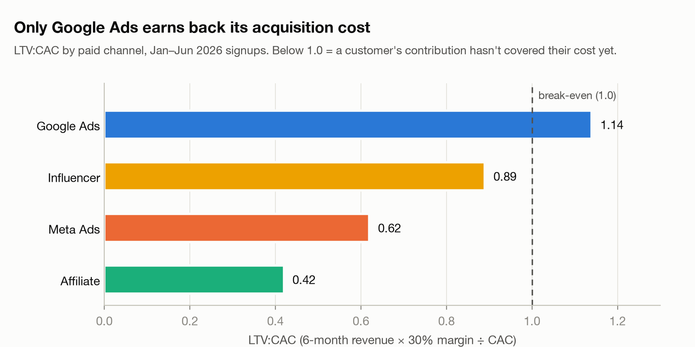
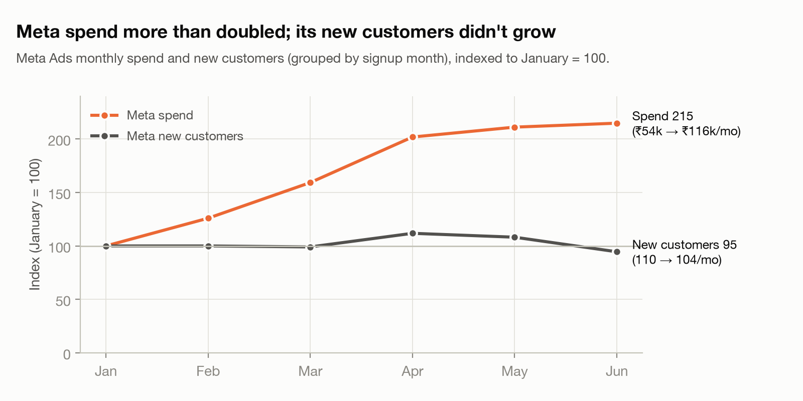
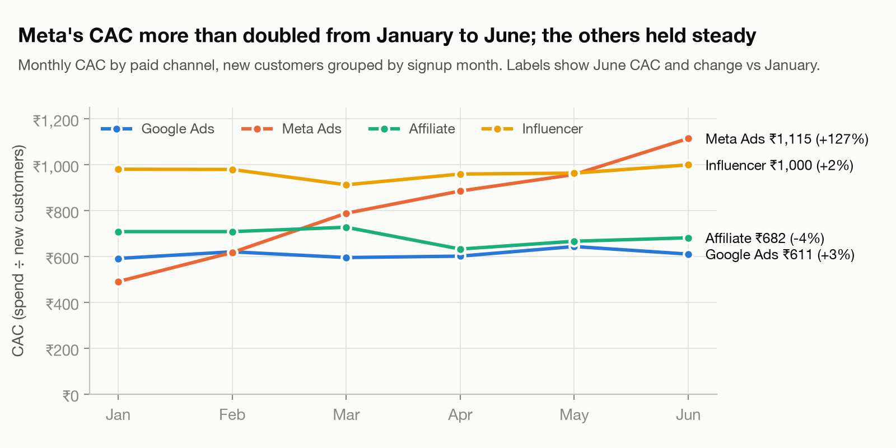

# Memo: where to cut paid spend next quarter

**To:** CMO, UrbanCart · **From:** Aryan Singh, Data & AI Engineer · **Date:** 24 Oct 2026

**Decision: cut ₹1.74L (20%) by taking ₹1.39L from Meta Ads and ₹35k from Affiliate. Keep Google Ads and Influencer at current levels.**

| Channel | Apr–Jun | Next quarter | Change |
|---|---|---|---|
| Meta Ads | ₹3.39L | ₹2.00L | −41% |
| Affiliate | ₹1.70L | ₹1.35L | −21% |
| Google Ads | ₹2.05L | ₹2.05L | 0% |
| Influencer | ₹1.54L | ₹1.54L | 0% |
| **Total** | **₹8.68L** | **₹6.94L** | **−20%** |

**Why Meta.** Meta's monthly spend doubled (₹54k → ₹116k) while new customers stayed flat (104–123 a month). Its CAC went from ₹491 to ₹1,115 (+127%); every other channel moved less than 4%. Q2's extra ₹1.31L over Q1 bought just 17 more customers: ₹7,706 each. At February's ₹68k, it still delivered 110 customers.

**Why Affiliate.** Lowest return of any channel (LTV:CAC 0.42): customers spend ₹957 on average, and only 8.1% buy again.

**Protect Google Ads.** The only channel above break-even (LTV:CAC 1.14), with CAC steady at ₹592–644 every month. Influencer stays flat: highest-value customers (₹2,858 each, 73% repeat).

**Impact.** About 67 fewer paid customers a quarter (−6%) and ₹23k less contribution, for ₹1.74L saved.

**Biggest risk.** Meta may not return to its January–February efficiency, and first-touch attribution may hide Meta's role in Organic signups.

**Watch weekly.** Meta new customers (act if under 95/month), Meta CAC (target ≤ ₹650), Organic signups, and Google CAC.

Basis: Jan–Jun 2026 data, cleaned as in Part 1. LTV = 6-month revenue × 30% margin; later signups had less time to repeat, so LTVs are conservative. Baseline = Apr–Jun spend.
