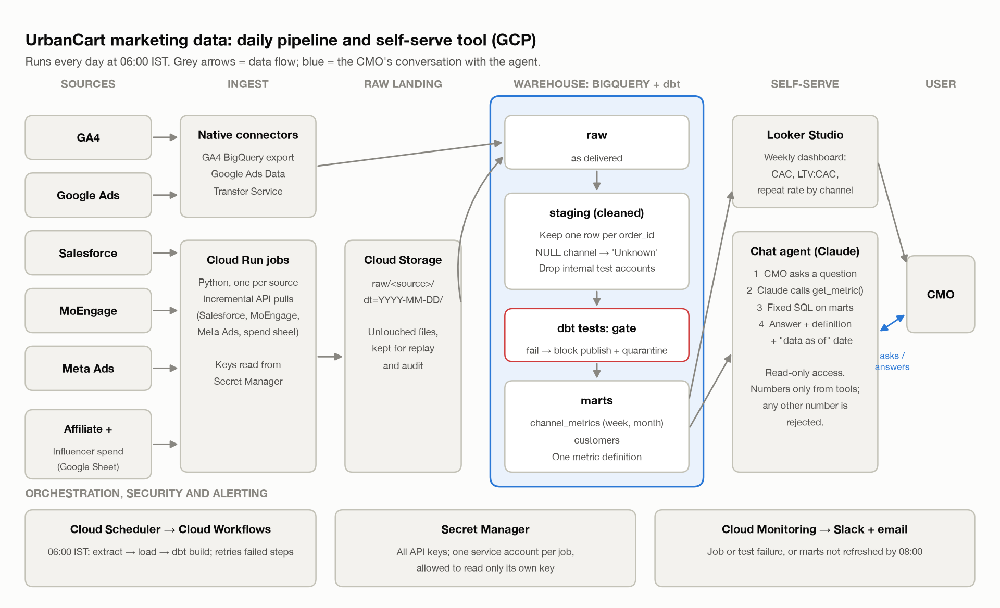

# Part 3: Automate and make it self-serve

## A. Daily pipeline on GCP

**Raw landing and warehouse.** Sources land untouched in Cloud Storage (`raw/<source>/dt=YYYY-MM-DD/`), so any day can be replayed, then loads into **BigQuery**, modelled with dbt: `raw` → `staging` (cleaned) → `marts` (metrics).
- GA4: native BigQuery export. Google Ads: BigQuery Data Transfer Service.
- Salesforce, MoEngage, Meta Ads: incremental Python API pulls on Cloud Run.
- Affiliate and influencer spend: a finance-owned Google Sheet.

**Scheduling.** Cloud Scheduler starts a Cloud Workflows run at 06:00 IST: extract → load → `dbt build`, retrying failed steps. (Composer is overkill for ~5 jobs.)

**Data quality.** Each Part 1 issue becomes a staging rule plus a dbt test:
- Duplicate orders: keep one per `order_id`; conflicting copies are quarantined and alerted.
- NULL channel → `Unknown`; warn above 2% of signups.
- Test accounts: excluded via a maintained internal-domain list.
- Also: valid `status`, no orphan orders, complete daily spend, row counts within ±30% of the 7-day average.

A failing test blocks publishing: the CMO sees yesterday's correct numbers, not today's wrong ones.

**Secrets and alerts.** API keys live in Secret Manager; each job's service account reads only its own. Cloud Monitoring posts failures to Slack and email; a freshness alert fires if marts aren't updated by 08:00, catching silent failures.

## B. Self-serve tool

A **Looker Studio dashboard** for the weekly view, plus a **chat agent (Claude)** for follow-ups. Both read only `marts.channel_metrics` (the Part 1 metrics per channel, per week and month) and `marts.customers`, through a read-only account.

**From question to answer:**
1. The CMO asks: "What was Meta's CAC last month?"
2. Claude resolves "last month" and calls a tool: `get_metric("CAC", "Meta Ads", "2026-09")`.
3. The tool runs a fixed, parameterised query. The model never writes SQL.
4. Claude replies with the number, definition and "data as of" date.

**No made-up numbers.**
- Metric formulas are defined once in dbt and shared by dashboard and agent.
- The model may state only tool-returned numbers; an automatic check rejects replies containing any other number.
- Unsupported questions get "I can't answer that yet" and the closest supported metric.

**Testing before handover.** ~50 golden questions with answers from the Part 1 notebook (e.g. Meta's June CAC = ₹1,115), including ambiguous and out-of-scope ones; numbers must match 100%, re-run on every change. Then a one-week pilot where an analyst checks answers against the dashboard.
